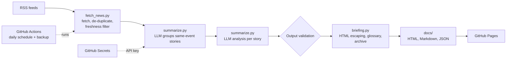

# AI Security Briefing Bot

An automated pipeline that collects security news every morning, uses an LLM to merge, summarize and triage each story, and publishes a plain-English daily briefing that tells readers what happened and what to do, with security controls built in at every stage.

**Live briefing:** https://deekgrs.github.io/security-briefing-bot/

## What it does

- Pulls the latest stories from The Hacker News, BleepingComputer and Krebs on Security via RSS, skipping anything older than 3 days
- Merges coverage of the same event from different outlets into a single story, with "Also covered" links to the others
- Sends each story to Google's Gemini model for a structured analysis: plain-English summary, category, severity, CVE IDs and affected vendors
- For Critical and High stories, adds a **What to do** section with separate advice for everyday readers and for IT teams
- Explains security jargon (zero-day, CVE, ransomware and more) with hover or tap definitions, so non-experts can follow along
- Builds a newspaper-style page with severity and category filters, story images and an archive of every past briefing
- Runs early every morning (about 4:30 AM Eastern) on GitHub Actions, with a backup run if GitHub's scheduler is delayed, and publishes to GitHub Pages at no cost

## Architecture



## Security design

The project treats everything from the internet, and everything from the AI model, as untrusted.

| Risk | Control |
|---|---|
| **Prompt injection:** a malicious article tells the model to ignore its instructions | Article text is wrapped in tags and the system prompt marks it as untrusted data |
| **Unreliable model output** | Category and severity must match fixed allow-lists; text fields are length-capped |
| **Hallucinated CVEs** | A CVE is kept only if it matches the CVE format **and** appears in the source text |
| **Manipulated story grouping** | The model only *suggests* groups; story numbers must exist and each story can join at most one group, so the worst a bad answer can do is fail to merge |
| **Harmful advice** | The code, not the model, decides which stories get "What to do" (Critical and High only), and any URL in the advice is stripped so readers are never pointed to a fake "patch" site |
| **Cross-site scripting** | All scraped and model text is HTML-escaped; links are restricted to `http(s)` and images to `https`; glossary definitions are fixed text inserted only after escaping |
| **Tampered archive data** | Saved briefings are re-validated with the same checks before archive pages are rebuilt |
| **Leaked API keys** | The key lives in `.env` locally (git-ignored) and in encrypted GitHub Secrets in CI |
| **Over-privileged automation** | The workflow token is limited to `contents: write`; the runner image is pinned |
| **Hanging or failing sources** | Every network call has a timeout; one failing feed or story never stops the run, and an empty run keeps the previous briefing instead of publishing a blank page |
| **Visitor privacy** | Images load with `no-referrer`, so news sites can't see which page visitors came from |

## Tech stack

Python · feedparser · requests · Gemini API (OpenAI-compatible endpoint) · GitHub Actions · GitHub Pages

## Run it locally

```powershell
git clone https://github.com/deekgrs/security-briefing-bot.git
cd security-briefing-bot
python -m venv .venv
.\.venv\Scripts\Activate.ps1
pip install -r requirements.txt
```

Create a `.env` file containing `GEMINI_API_KEY=your-key` (a free key is available from Google AI Studio), then run:

```powershell
python briefing.py                  # full run: fetch, analyze, publish
python briefing.py --archive-only   # rebuild the archive from saved data, no AI calls
```

## Project structure

```
fetch_news.py      Fetches recent RSS stories with timeouts and a freshness filter
summarize.py       Groups same-event stories, runs the LLM analysis, validates output
briefing.py        Renders the HTML, Markdown and JSON briefing and the archive
.github/workflows  Daily scheduled pipeline with a backup run
docs/              Published briefing and archive (GitHub Pages)
```

## Coming in version 2

- Flag CVEs listed in CISA's Known Exploited Vulnerabilities catalog
- Enrich CVEs with CVSS scores from the NIST NVD API
- Filter out sponsored and vendor-marketing articles
- Pin GitHub Actions to commit SHAs for supply-chain hardening

## Acknowledgements

The "What to do" section came from feedback by a friend, Madhu, who asked: as a user, what should I actually do?