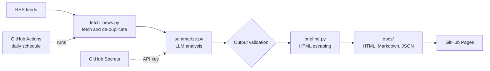

# AI Security Briefing Bot

An automated pipeline that collects security news every morning, uses an LLM to summarize, categorize and triage each story, and publishes a daily briefing, with security controls built in at every stage.

**Live briefing:** https://deekgrs.github.io/security-briefing-bot/

## What it does

- Pulls the latest stories from The Hacker News, BleepingComputer and Krebs on Security via RSS
- Sends each story to Google's Gemini model, which returns a structured analysis: two-sentence summary, category, severity, CVE IDs and affected vendors
- Validates every field the model returns before it is used
- Builds an HTML briefing sorted by severity, plus Markdown and JSON archives
- Runs daily at 7:17 AM Eastern on GitHub Actions and publishes to GitHub Pages, with no server and no cost

## Architecture



## Security design

The project treats everything from the internet, and everything from the AI model, as untrusted.

| Risk | Control |
|---|---|
| **Prompt injection:** a malicious article tells the model to ignore its instructions | Article text is wrapped in `<article>` tags and the system prompt marks it as untrusted data |
| **Unreliable model output:** the model returns unexpected values | Category and severity must match fixed allow-lists; text fields are length-capped |
| **Hallucinated CVEs:** the model invents plausible-looking CVE IDs | A CVE is kept only if it matches the CVE format **and** appears in the source text |
| **Cross-site scripting:** a headline containing `<script>` runs on the public site | All scraped and model text is HTML-escaped; links are restricted to `http(s)` |
| **Leaked API keys** | The key lives in `.env` locally (git-ignored) and in encrypted GitHub Secrets in CI |
| **Over-privileged automation** | The workflow token is limited to `contents: write` |
| **One failing feed or API call** | Errors are handled per feed and per story, so the briefing still publishes |

## Tech stack

Python · feedparser · Gemini API (OpenAI-compatible endpoint) · GitHub Actions · GitHub Pages

## Run it locally

```powershell
git clone https://github.com/deekgrs/security-briefing-bot.git
cd security-briefing-bot
python -m venv .venv
.\.venv\Scripts\Activate.ps1
pip install -r requirements.txt
```

Create a `.env` file containing `GEMINI_API_KEY=your-key` (a free key is available from Google AI Studio), then run:

```powershell
python briefing.py
```

## Project structure

```
fetch_news.py      Fetches and de-duplicates RSS stories
summarize.py       LLM analysis and output validation
briefing.py        Renders the HTML, Markdown and JSON briefing
.github/workflows  Daily scheduled pipeline
docs/              Published briefing (GitHub Pages)
```

## Possible next steps

- Merge duplicate coverage of the same story across sources
- Enrich CVEs with CVSS scores from the NIST NVD API
- Cross-check against the CISA Known Exploited Vulnerabilities catalog
- Pin GitHub Actions to commit SHAs for supply-chain hardening